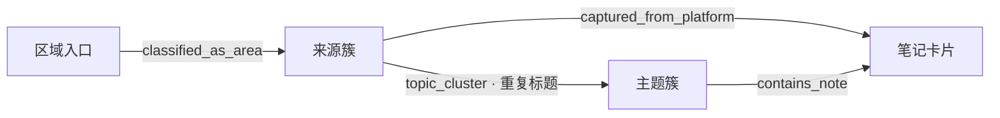
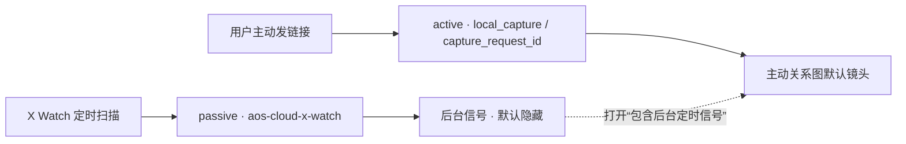
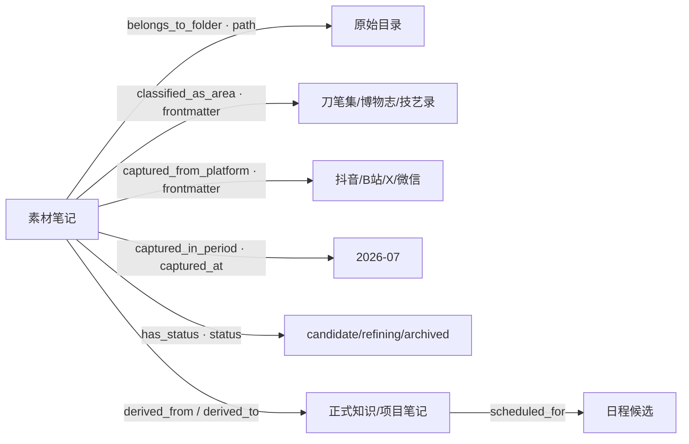

# 收件箱关系地图：用语义连线穿透目录层级

> 状态：三层关系图谱模板已接入 Scriptorium 收件箱地图；默认镜头为可读语义总览，点击后才进入全宽自由关系图聚焦，主动采集镜头已接入，正式 UI 肉眼验收仍待完成。

## 1. 核心判断

收件箱的目录是“原始证据的存储位置”，不应该继续承担所有分类职责。现在的路径可能同时编码：

```text
收件箱 / 刀笔集 / 抖音 / 2026-07 / 某条素材.md
```

这对文件管理有用，但对阅览不友好：用户必须逐层展开，而且一个笔记无法自然表达“既属于写作方法，又来自抖音，又是本周高时效候选”。

关系地图采用正交维度，但不把所有维度同时画成节点：笔记卡片沿着“区域 → 来源簇 → 主题簇（可选） → 笔记”的关系图谱模板展开；目录、时间和生命周期保留为筛选/详情元数据，连线带关系类型和证据来源。

### 1.1 当前收件箱模板（数据层已接入，自由布局渲染）



同一 `area + source_platform` 的笔记进入一条来源簇；相同或高度相似标题只有在至少两条时才聚合成主题簇。这样不会再生成“待分区 47”或“X 43”这种中心节点，也不会把 `status/period/folder` 变成每篇笔记的额外连线。

模板只规定“谁和谁有关系”，不规定屏幕上必须排成三列。当前运行时以径向种子加有界力场自由散开，支持拖拽、滚轮缩放、空白区平移和适配画布；视觉上更接近 Obsidian 原生关系图，而不是思维导图。

### 1.2 主动采集与后台信号镜头

X Watch 的定时扫描会产生大量低价值或闲聊推文。它们保留在原始卷宗中，但默认不进入关系图主镜头：



`captureMode` 只读消费 frontmatter，不回写文件：`active`、`passive`、`unknown`，并附 `captureModeEvidence`。没有证据时保留 `unknown`，不把模型猜测当成事实。

## 2. 推荐的节点与连线



| 维度 | 图上节点 | 连线类型 | 真源 |
| --- | --- | --- | --- |
| 内容 | 原始收件箱笔记、正式笔记 | `derived_from`、`related_to` | 文件与双链 |
| 归属 | 刀笔集、博物志、技艺录、二流小说家 | `classified_as_area` | `area` |
| 来源 | 抖音、B站、X、微信、手动 | `captured_from_platform` | `source_platform` |
| 时间 | 年/月/周，按缩放动态聚合 | `captured_in_period` | `captured_at` |
| 生命周期 | captured、candidate、refining、scheduled、archived | `has_status` | `status` |
| 存储 | 具体目录或 MOC | `belongs_to_folder` | `source_note_path` / 文件路径 |

这里的“刀笔集、博物志、技艺录”等是图上的 MOC/area 展示名，不急着新增一套 frontmatter 字段；若当前 `area` 只有较宽的值，先从已有路径或 MOC 推断并标记 `evidence: inferred`，等真实使用后再决定是否扩充受控词表。

连线的 `metadata` 至少包含：

```yaml
relationType: captured_from_platform
facetKind: platform
value: douyin
evidence: frontmatter
confidence: explicit
sourcePath: 00_松果池（收件箱）/抖音/2026-07/素材.md
```

## 3. 不要把所有连线同时画出来

地图需要“镜头”，而不是一张永远打开的毛线团：

1. **总览镜头**：只显示 area、platform、project 等聚合节点；显示数量和最近更新时间。
2. **收件箱镜头**：显示最近/待处理笔记，默认采用 area → platform/cluster → note 三层模板，目录不再成为中心节点；“按目录拆分来源簇”只改变来源簇粒度。
3. **时间镜头**：以月/周为时间节点，只有缩放到局部时才展开日期，避免每天生成一个节点。
4. **追踪镜头**：只显示 `capture → raw → agent → formal → schedule` 的生命周期链。
5. **聚焦镜头**：选中笔记后只展开一跳或两跳邻域，直接打开来源笔记或派生笔记。

因此“刀笔集/抖音/2026-07”不会被渲染成三层目录，而是三个可开关的语义维度。

## 4. 与现有 `aos-capture/v1` 的对应

图谱不新增一套漂移字段，直接消费现有契约：

```text
area              → classified_as_area
source_platform   → captured_from_platform
captured_at       → captured_in_period
status            → has_status
source_note_path  → belongs_to_folder / note identity
derived_note_path → derived_to
agent_status      → 追踪镜头的 Agent 阶段
```

旧笔记缺少 frontmatter 时，可以从路径推断并标记 `evidence: inferred`，只影响图上展示，不回写文件。

## 5. 最小落地顺序

1. [x] 以只读 manifest 生成笔记卡片与三层模板节点，不移动旧文件。
2. [x] 接入“收件箱镜头”：默认显示区域/来源入口，按需展开最近候选，点击笔记直接打开原文。
3. [x] 加入 area/platform/status/时间四个轻量筛选器。
4. [x] 接入来源簇/主题簇聚合、目录粒度开关和区域/来源反向筛选。
5. [ ] 接入生命周期追踪镜头。
6. [ ] 最后把灵感卡、正式笔记和日程候选接成 `derived_to` / `scheduled_for`。

### 5.1 2026-07-28 自由图运行时与性能边界（执行窗口：地炉）

- `src/aetheric/InboxGraphRuntime.ts` 是 Scriptorium 专用的轻量运行时，不把二流小说家的 React/Sigma 业务壳搬进 Obsidian。
- 单帧只更新一次 SVG world transform；布局缓存保存归一化坐标，筛选或重载后不必从固定列重新跳排。
- 默认镜头最多 48 条笔记，显式上限 120；节点超过 80 时减少迭代次数。后续若要看全库，应先做聚合节点或聚焦镜头，而不是解除上限。
- 选中或悬停节点时只强调一跳邻居，无关节点/边降到低透明度；窗口尺寸变化按比例调整节点坐标，避免侧栏收缩后布局跳回固定列。
- 建议性能验收：打开地图后拖拽 10 秒、滚轮缩放 10 次、切换“包含后台信号”两次；确认无长时间主线程阻塞、无残留 RAF/ResizeObserver。

## 6. 风险与验收

- 目录边不能被误解为唯一分类；一个笔记可以同时连接多个 facet。
- 模型推断出的价值/时效必须标成建议值，不能直接成为正式分类。
- 大图仍使用聚合与聚焦，不把全库笔记一次性交给 SVG 力场。
- 浏览器验收应确认：点击节点能定位到真实笔记，切换镜头不会写回 Vault，隐藏/展开目录边不会改变原始文件。

## 7. 研究借鉴与新增方向

### 7.1 2026-07-28 模板与镜头重构记录（执行窗口：地炉）

- 完成：新增 `buildInboxTemplateGraph`，将收件箱地图从全量分面直连改为 `区域 → 来源簇 → 主题簇（可选） → 笔记卡片`；`status/period/folder` 不再默认生成图节点。
- 聚合：同一来源簇内重复标题仅在数量大于 1 时生成主题簇，保留 `memberPaths` 与原始笔记点击入口；缺失属性仍以虚线/推断证据呈现。
- UI：地图改为全宽自由关系图，使用曲线关系边、区域圆形、来源胶囊、主题簇和笔记卡片；支持拖拽/缩放/平移/适配画布，点击主题簇可进入临时聚焦，点击区域/来源可反向筛选。
- 来源治理：`captureMode` 将 X Watch 定时信号与用户主动链接分开；默认只展示主动镜头，后台信号仍可用开关查看。
- 灵感卡修复：整理按钮不再先后调用两次 `openNode`，避免两个布局事务竞争；Copilot 投喂增加 45 秒超时，布局遮罩增加 8 秒 watchdog，失败时不再永久卡在加载层。
- 验收证据：`npm run build` 通过并部署到本机 Scriptorium；适配器模板契约测试通过；外部环境完整 `npm test` 通过（Worker 6/6、Agent Dock 13/13、布局 10/10、Copilot 11/11）。
- 当前真实状态：代码已部署，等待用户重载 Obsidian 对地图视觉与“整理”按钮做肉眼验收；未移动、覆盖或改写任何旧收件箱笔记。
- 风险/限制：默认上限约 48 条笔记（显式上限 120），当前力场排斥仍为有界 O(n²)；主题簇按标题归一化而非语义相似度；尚未完成真实 Vault p95 帧时间测量。
- 回滚：知识库页可切回原生关系图；恢复旧 `drawInboxTemplateGraph` 调用与旧样式即可撤回自由运行时。构建产物回滚以本次部署前的插件目录副本为准。

这套设计不是把“关系图”当装饰，而是吸收了几条成熟路线：

- Bush 的 Memex 设想批评单一路径的层级索引，强调可保存、可回放的 associative trail；AOS 对应为“研究路线”，把用户从一张素材卡走到方法论、正式笔记和日程的路径保存下来。
- 分面导航研究强调一个对象可以同时拥有多个正交 facet，而不是只能放在一个文件夹；因此 area、平台、时间、状态必须可并行筛选。Hearst 还特别强调筛选要和关键词搜索、结果预览、历史面包屑结合，不能只给一张图。
- RDF/PROV 把关系写成带谓词的声明，并保留来源；AOS 的边必须带 `relationType`、`evidence`、`confidence` 和时间，而不是只画一条无语义的线。
- 信息可视化遵循“总览 → 缩放/筛选 → 按需详情”的路线；缩放时应改变信息粒度（聚合节点变成笔记卡），而不只是把同一堆点放大。
- 大型网络存在 hairball 问题；聚合、边捆绑和镜头切换比单纯更换渲染器更重要。

### 新增的三个产品主意

1. **研究路线（Trail）**：用户可以把当前探索路径保存成一条可回放线路，例如“抖音素材 → 节奏感 → 写作方法论 → 二流小说家项目”。路线是工作产物，不改原笔记。
2. **关系真值分层**：实链（路径、frontmatter、双链）用实线；Agent 推断用虚线；语义相似度用淡点线；用户确认的关系用强调色。点击边可查看“为什么相连”。
3. **图谱不是唯一视图**：关系图用于发现上下文，列表用于精确定位，卡片用于处理，时间线用于新旧变化；同一份图数据可切换为关系图、矩阵、时间线或采集→整理→日程的流图。

### 7.2 2026-07-29 · 收件箱默认镜头去毛线团

- 默认 `detail=overview`：只渲染区域、来源簇和重复主题簇，不渲染每一条笔记标题；`detail=focus` 才生成 note 节点。地图旁的“当前镜头笔记”列表始终负责精确打开原始 Markdown。
- 点击区域/来源/主题簇会自动切入聚焦镜头；“总览入口”可返回，不通过重新移动文件解决可读性问题。
- 这次改动修正了设计与 UI 的脱节：关系图是入口地图，不是收件箱文件列表的另一种拥挤排版。实际 Vault 内容、主动/被动采集判定和原始路径均保持只读。
- 已构建并部署，外部契约测试全通过；待用户重载 Obsidian 肉眼确认节点密度、镜头切换和打开原文行为。
