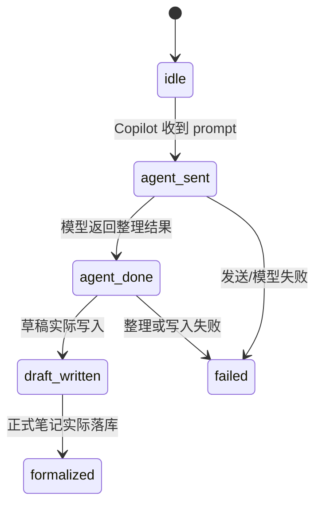

# AOS Capture Lifecycle Contract

> 版本：`aos-capture/v1`  
> 目标：让“链接/微信 → 原始收件箱 → 灵感卡 → Copilot → 日程/正式笔记”只有一套可追踪字段。

## 设计边界

本契约是元数据契约，不是目录迁移方案。现有平台目录继续保留原始证据和双链；灵感轨、候选池、日程是虚拟索引。历史笔记先只读审计，不批量搬迁或覆盖。

## 冻结字段

```yaml
contract_version: aos-capture/v1
type: capture | inspiration_card | knowledge_note | project_note
status: captured | candidate | refining | refined | scheduled | archived
source_platform: weixin | bilibili | douyin | xiaohongshu | x | manual
inbox_channel: weixin_hermes | bookmarklet | local_capture | x_watch
source_url:
source_note_path:
capture_id:
capture_request_id:
evidence_level:
area:
value_score:
freshness:
next_action:
derived_note_path:
agent_status: idle | agent_sent | agent_done | draft_written | formalized | failed
```

### 字段语义

| 字段 | 含义 | 写入规则 |
| --- | --- | --- |
| `type` | 当前文档角色 | 新捕获为 `capture`；显式登记后为 `inspiration_card`；正式派生文档才用 `knowledge_note` / `project_note` |
| `status` | 原始资料的生命周期 | 采集完成为 `captured`；挂入候选池为 `candidate`；整理中/完成为 `refining`/`refined`；接入计划为 `scheduled`；保留证据但不再展示为 `archived` |
| `source_platform` | 原始来源平台 | 只使用冻结枚举；无法判断写 `manual`，不得从标题猜成平台 |
| `inbox_channel` | 进入收件箱的入口 | 微信 Hermes、书签端、本机采集、X Watch 四选一 |
| `source_url` | 原始 HTTPS 链接 | 不再新写 `url`；没有链接的微信想法可为 `null` |
| `source_note_path` | 原始卷宗相对 Vault 路径 | 正式笔记通过它回链原文 |
| `capture_id` | 一次捕获的稳定标识 | 优先使用上游 ID；缺失时由 URL/时间/内容 SHA 派生 `cap-...` |
| `capture_request_id` | 跨端/采集任务请求标识 | 没有请求桥时为 `null`，不要伪造任务已提交 |
| `evidence_level` | 证据强度 | 由适配器报告；不能把标题/摘要当作全文证据 |
| `area` | 虚拟分区 | `knowledge`/`life`/`project`/`radar`/`erliu`/`inbox` |
| `value_score` | 价值密度 | 可以有 Hermes 建议值，但在用户确认或整理落库前保持 `null`/建议层 |
| `freshness` | 时效性 | 采集器按时间给出 `hot`/`warm`/`evergreen` 候选；过期判断不能删除证据 |
| `next_action` | 下一步动作 | `review`/`deepen`/`schedule`/`link`/`archive` 等工作流动作 |
| `derived_note_path` | 正式派生笔记相对路径 | 只有实际写入后才填；不以 prompt 发送代替 |
| `agent_status` | Agent 处理状态 | 与 `status` 独立，精确记录发送、完成、草稿和正式化阶段 |

## Agent 状态机



`agent_sent` 只能证明消息已投递；不得把它报告为 `refined`、`draft_written` 或 `formalized`。失败时保留原始卷宗和失败原因，允许重试。

## 来源映射

| 来源 | `source_platform` | `inbox_channel` |
| --- | --- | --- |
| 微信 Hermes 想法/附件 | `weixin` | `weixin_hermes` |
| 书签端/网页按钮 | 由 URL 判定 | `bookmarklet` |
| 本机终端/工作台采集 | 由 URL 判定 | `local_capture` |
| 云端 X Watch | `x` | `x_watch` |

B站、抖音、小红书等平台不是新的 `inbox_channel`；它们只体现在 `source_platform`，入口仍由上表决定。

## 旧字段兼容策略

读取层可以兼容 `url`→`source_url`、`source_note`→`source_note_path`、`source`→`source_platform` 的历史写法，并把 `pending`/`reviewed`/`deepened`/`project_candidate` 显示为候选标签；新写入一律只写冻结字段。兼容映射不得在只读 manifest 阶段回写 Vault。

## 验收顺序

1. 新采集样本在写入收件箱时生成完整 frontmatter。
2. 工作台生成只读来源候选和灵感轨卡片。
3. B站、抖音、X、微信想法各选一篇，核对来源平台、入口、证据等级、原文回链和当前缺字段。
4. 点击“登记正式卡”只修改单篇 frontmatter；点击“整理”只把 Agent 状态推进到 `agent_sent`。
5. 只有真实草稿/正式笔记写入后才推进后续状态。

验收证据写入项目 `scratch/` 或待合并日志，不把密钥、Cookie、Token 或隐私内容写入契约文档。
