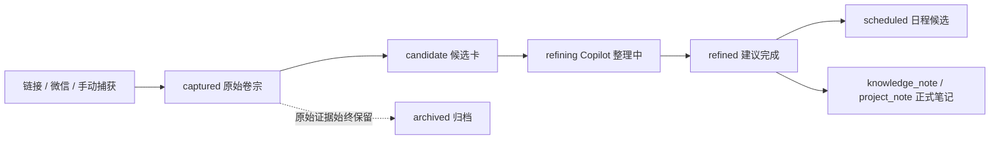

# 松果池收件箱：生命周期路由

## 先说结论

收件箱的物理目录继续保留为原始证据层，不因为“灵感轨”再搬一遍文件。目录回答“资料从哪里来”，统一 frontmatter 回答“资料现在处于什么生命周期、下一步该做什么”。灵感轨、候选池和日程都是这些字段的虚拟索引。

现有双链不动；旧笔记先只读盘点，只有新的 capture 或用户明确触发的单篇动作才补齐元数据。

## 物理来源层

`00_松果池（收件箱）/` 继续按来源保留原始卷宗：

- `B站/`、`抖音/`、`小红书/`、`X情报/`：平台原文、字幕/ASR、媒体和证据。
- `微信想法/`：云端 Hermes 转交的想法、截图说明和跨端灵感捕获。
- `GitHub/`、`大众点评/`、`其他/`：其它来源的原始捕获。
- `00_残卷回收站/`：治理文件，不进入候选池。

这些目录不是新的分类系统，也不是搬迁目标；它们是“原始卷宗”入口。

## 冻结 frontmatter 契约

新捕获在写入收件箱的同一刻必须生成以下字段。字段名和允许值冻结在 `aos-capture/v1`；缺少值时使用 `null`，不能用同义字段代替：

```yaml
type: capture | inspiration_card | knowledge_note | project_note
status: captured | candidate | refining | refined | scheduled | archived
source_platform: weixin | bilibili | douyin | xiaohongshu | x | manual
inbox_channel: weixin_hermes | bookmarklet | local_capture | x_watch
source_url:
source_note_path:
capture_id:
capture_request_id:
evidence_level:
area:
value_score:
freshness:
next_action:
derived_note_path:
```

`contract_version: aos-capture/v1` 是契约版本标记，可与上述字段一起出现。`agent_status` 是独立的 Agent 工作状态，不和生命周期 `status` 混用：

```yaml
agent_status: idle | agent_sent | agent_done | draft_written | formalized | failed
```

`value_score`、`freshness` 如果由 Hermes 初判，必须标记为建议值（例如在 Agent 输出或审计 manifest 中），未经用户/整理流程确认不得当成正式事实写回。

### 旧字段兼容

历史笔记里的 `url`、`source`、`source_note`、`pending`、`reviewed`、`deepened`、`project_candidate` 等字段只作为读取兼容，不再由新代码写入。展示层可把它们映射到候选值，但不得在只读推断时修改原文；正式动作只能写冻结字段。

## 生命周期与工作流



Agent 状态另行记录：

```text
idle → agent_sent → agent_done → draft_written → formalized
                    └──────────────失败──────────────→ failed
```

“prompt 已发送”只代表 `agent_sent`，不代表整理完成；只有收到模型结果才可到 `agent_done`，写出草稿才是 `draft_written`，正式落库才是 `formalized`。

## 路由原则

1. 新链接/微信消息先写原始收件箱，并带完整契约字段。
2. 工作台读取契约生成来源候选和灵感轨；缺字段的旧笔记只显示“待核验”，不靠标题猜测后写回。
3. 用户点击“登记正式卡”才把单篇 `type` 变为 `inspiration_card`、`status` 变为 `candidate`；正文、路径和双链不复制、不移动。
4. Copilot “整理”只发送结构化 prompt，并把 `agent_status` 更新为 `agent_sent`；模型完成、草稿写入和正式化分别更新各自状态。
5. 日程只消费 `inspiration_card` 的候选投影，使用 `source_note_path` 回链原始卷宗，不直接扫描整个原始平台库。
6. 归档只写 `status: archived`；恢复写回 `candidate`，原始证据仍留在原路径。

### 定时监测不是自动灵感

`source: aos-cloud-x-watch`、`inbox_channel: x_watch`、`capture_mode: passive/scheduled`、`primary_topic: watched_account` 或 `topics: x_watch` 等定时 watcher 产物默认只进入原始收件箱与情报视图，不自动进入“最近平台候选”，也不因路径、`云端监测`/`灵感`标签、`signal` 或 `value_score` 而挂上灵感轨。满足以下任一显式提升条件后才进入：

- `type: inspiration_card`
- `rail: inspiration`（或 `rail: 灵感`）
- `promote_to_inspiration: true`
- 用户/Agent 执行“登记正式卡”；该动作会写入上述字段
- `value_score >= 4`
- `signal: high/critical`，且 `analysis_status` 不是 `failed/error/blocked/insufficient_evidence`

主动发送链接、书签采集和本机手动采集仍保留自动候选预览，不受 watcher 过滤影响。

### 来源平台不等于内容分区

`source_platform: x` 只回答“证据来自 X”，不能覆盖内容本身的长期归属。灵感轨分区优先级固定为：

1. `rail_area` / `area_override` / `inspiration_area` 显式覆盖；
2. 物理路径和 `分流建议` 中的稳定语义（技艺录、思辨录等进入知识轨）；
3. 教程、方法、指南、工作流、拆解、复盘等可复用内容进入知识轨；
4. `area` / `分流方向` 等旧字段；
5. 无语义的高价值定时 watcher 才进入信息雷达轨。

因此 X 上的方法论、教程和工具实操不再因为 URL 是 X 而被硬塞进信息雷达轨。

## 分流 Skill 选择

路由判断遵循“用户意图优先”：

- 职场段子、对话和社会锐评 → `刀笔集（锐评与观察）` / `obsidian-dialogue-universe`。
- 哲学思辨、认知模型 → `思辨录（认知与方法论）` / `obsidian-dialogue-universe`。
- 音乐、电影常识、自然、商业等陌生领域科普 → `博物志（见闻与科普）` / `obsidian-science-notes`。
- 脚本、部署、Playwright、API、自动化 → `技艺录（技术与工具）` / `obsidian-practical-tech`。
- 编译原理、数据结构、计组、实验报告 → `格物院（课程与学科）` / `obsidian-academic-notes`。

若意图冲突且无法判断，输出两个候选路由并说明理由，不擅自移动文件。

## 治理顺序

```text
只读审计 → inbox manifest → 四平台样本验收 → 小批量补字段 → 用户验收 → 可回滚变更
```

manifest 是证据和计划，不是迁移脚本；任何移动、覆盖、删除或批量改写都必须另行授权并保留回滚材料。
