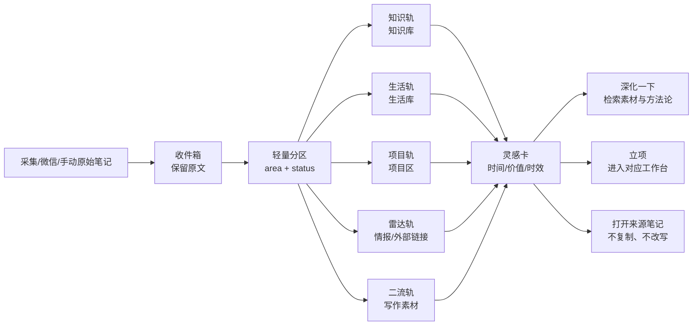

# 灵感轨（Inspiration Rails）设计说明

> [!summary] 一句话
> 收件箱负责把资料接住，灵感轨负责把值得继续处理的东西挂到可扫读、可深化、可立项的时间线上。

## 命名

本功能的正式名称暂定为 **灵感轨**（复数页面称“灵感轨道”）；“横杆”是交互隐喻。每个分区一条轨道，轨道上的卡片按捕获时间从新到旧排列。这个名字比“灵感横杆”更短，也能覆盖未来的纵向时间轴、筛选和拖拽能力。

## 设计目标

- 不改变原始 Markdown：轨道是工作台的展示层，点击卡片仍打开来源笔记。
- 收件箱资料按 `area` 分流为独立轨道：知识库、生活库、项目、信息雷达、二流小说家；没有 `area` 的旧笔记进入“待分区”。
- 左侧为最新、右侧为较旧；时间来自 `captured_at`/`created_at`，缺失时回退到文件修改时间。
- 卡片把状态、价值密度、时效性放在第一视线，并预留“深化”“立项”两个动作。
- 鼠标靠近轨道左右边缘时自动横向滑动，离开或移动到中间立即停止；键盘仍可用原生横向滚动。

## 卡片字段（frontmatter）

```yaml
type: inspiration_card
area: knowledge | life | project | radar | erliu | inbox
status: captured | candidate | refining | refined | scheduled | archived
captured_at: 2026-07-28T12:00:00+08:00
source_platform: weixin | bilibili | douyin | xiaohongshu | x | manual
inbox_channel: weixin_hermes | bookmarklet | local_capture | x_watch
source_url: https://example.com
source_note_path: 00_松果池（收件箱）/抖音/2026-07/素材.md
capture_id: cap-example
capture_request_id: request-example
evidence_level: asr_full
value_score: null
freshness: hot | warm | evergreen
next_action: review | deepen | schedule | link | archive
derived_note_path: null
agent_status: idle | agent_sent | agent_done | draft_written | formalized | failed
```

以上是 `aos-capture/v1` 的冻结字段；详细契约见 `CAPTURE_LIFECYCLE_CONTRACT.md`。旧笔记没有这些字段时，前端只做推断，不回写文件：`area` 从路径/来源推断，`freshness` 按时间推断，`value_score` 显示“未评估”。模型对价值和时效的判断先停留在建议层。

> [!rule] 被动监测不等于灵感意图
> `aos-cloud-x-watch` / `inbox_channel: x_watch` / `capture_mode: passive` 等定时 feed 默认只进入收件箱与情报视图，不自动占用灵感轨。`value_score`、`signal` 和通知优先级只决定情报页是否醒目，不能代替用户的灵感意图；只有显式 promotion 才能进入灵感轨。主动发送链接、书签与本机手动采集仍可进入最近候选预览。

> [!rule] 平台是来源，不是分区
> X 方法、教程、工作流和复盘仍属于知识轨。轨道优先读取 `rail_area` 显式覆盖、物理路径与 `分流建议`，再看内容语义和旧 `area`；不再使用“X URL ⇒ 信息雷达轨”的硬编码。

## 页面概念图



## 当前 MVP 与下一步

当前 MVP 只改工作台展示层：真实文件索引 → 分区轨道 → 卡片点击；边缘自动滑动和状态胶囊已实现。`深化`/`立项`按钮目前打开来源笔记并提示下一步，未伪造后端写入。

### 与日程 Schedule 的融合（MVP）

灵感轨不再只是一个独立浏览页。日程页底部新增“灵感挂接 · 从卡片到计划”横向停靠区：

```mermaid
flowchart LR
    capture[微信/爬虫捕获] --> rail[灵感轨卡片]
    rail --> preview[日程页灵感挂接区]
    preview -->|查看| note[打开来源笔记]
    preview -->|挂入计划| plan[PlanItem]
    plan --> event[计划事件流]
    plan -. source_note.path .-> note
```

“挂入计划”会预填卡片标题、日期和未排期状态；计划事件额外保存可选的 `source_note: { path, kind: inspiration }`，因此日程卡片能回到原始灵感而不复制或改写原笔记。已经挂接的时间轴卡片会显示“灵感挂接”标记，详情侧栏提供“打开灵感卡”。旧的 `PlanItem` 和旧清单没有该字段时保持完全兼容。

这一层只做显式用户动作，不自动把所有灵感变成任务；自动推荐/深化仍留给后续 Agent 动作契约。

### 卡片生命周期

候选池不再是一组无法解释来源的临时卡片，而是灵感轨的一个投影：

```text
captured → candidate → refining → refined → scheduled → archived
                         │           │
                         │           └─ 挂入计划：PlanItem.source_note.path
                         └─ Agent 状态另记：agent_sent → agent_done → draft_written → formalized
```

灵感卡上的“已整理”与“归档”只更新该笔记的 frontmatter 状态并保留正文；归档卡片从默认灵感轨、日程候选池隐藏，但在灵感区的时间归档中仍可恢复为 `candidate`。日程项自身的完成状态（`planned` / `done`）与灵感卡状态分离，因此完成一次计划不会误删来源卡片。Copilot 已发送不等于整理完成，必须分别记录 Agent 状态。

### X / EvidencePacket 媒体入口（只读）

灵感卡可以消费来源笔记已经写入的媒体字段，不主动发起新的采集：

| 来源字段 | 展示行为 |
| --- | --- |
| `cover_image` / `coverImage` / `cover` | 卡片顶部封面预览；显式远程 URL 优先，旧笔记的本地 `cover` 作为兼容回退 |
| `images` / `image_list` / `imageList` | 显示“图集 · N 张”胶囊，第一张可作为预览 |
| `media.cover_image` / `media.images` | 兼容 EvidencePacket 规范化后的嵌套媒体对象 |
| `source_url` / `url` | 显示“原帖”导航入口，仅打开已记录的 HTTPS 链接 |

远端 URL 只作为已有证据的预览地址，缺失或失效时显示“媒体已捕获”占位，不回写 Markdown、不下载图片，也不代表 `gallery-dl` 已部署。平台主动采集卷宗可作为最近候选预览；定时 X watcher 只有显式 promotion 后才进入灵感轨，高价值门只服务信息雷达。

下一阶段才接 Hermes 的结构化动作：

1. `灵感 xxx` 创建带 `type: inspiration_card` 的选题卡；
2. `深化一下` 读取卡片关联的素材和方法论，追加草稿；
3. `给我 5 个选题` 只读取已授权的近期卡片和外部采集结果，按价值/新鲜度排序；
4. 卡片达到 `project_candidate` 后由用户/Agent 选择目标工作台。

## 风险与验证

- 轨道不等于自动分类器；没有可靠字段时只能显示“待分区”，避免把猜测写回正式 Vault。
- 自动横滑必须尊重 `prefers-reduced-motion`，大量卡片时只滚动容器，不重复渲染 Markdown。
- 原始链接作为待分析来源保留：<https://x.com/Pluvio9yte/status/2081648099680743554?s=20>；本轮未声称抓取该帖正文。
